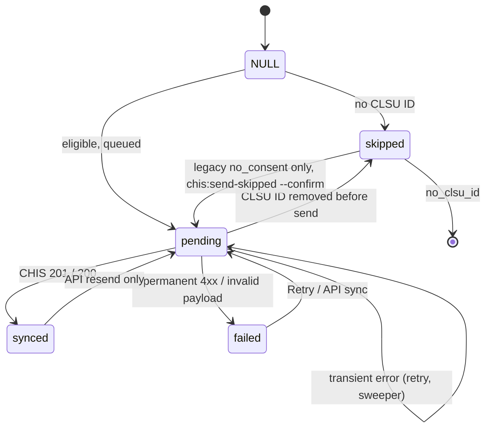

# CHIS Integration (Simulated CHIS)

> Terminology follows `docs/paper/glossary.md` (§15 for CHIS terms). Figure and
> table numbers use the `X.n` placeholder pending final manuscript numbering.
> **No credential value appears in this document — only configuration variable
> names.**
>
> **Scope of the claim.** This feature is an integration with a **simulated
> CHIS**: a separate application (repository `clsu-chis-simulation`) built by the
> team to a REST contract the team wrote, because no real CHIS API specification
> was available. Nothing in this document describes, or may be read as
> describing, a connection to CLSU's actual CHIS. Connecting to the real CHIS
> would require changing `CHIS_BASE_URL` / `CHIS_TOKEN` and, if its contract
> differs, `ChisClient` and `ChisEncounterPayload`. The payload is plain JSON
> loosely modelled on the shape of FHIR *Encounter* and *Patient*; it is **not**
> HL7 FHIR.

## 1. Feature Name

CHIS Integration — Telemed exchanges data with a simulated CHIS
(Comprehensive Health Information System) in two directions: it **sends** a
summary of each completed consultation session (outbound encounter push), and it
**receives** the patient's medical profile for the assigned physician (inbound
patient lookup). Neither direction asks for patient consent: both rest on the
lawful basis "medical treatment" (§2.1), patients are told through a privacy
notice, both are recorded in an append-only audit log, and a small token-protected REST API lets
an administrator trigger and observe a sync.

## 2. Purpose

The Patient tab of the consultation screen was originally a set of hardcoded
"No Data" placeholders (see `00-feature-inventory.md`, *Superseded* note). This
feature replaces them with real data from a CHIS and sends the clinical outcome
back, under the Data Privacy Act (RA 10173) constraints the code encodes:

- no patient consent is asked: the lawful basis is *medical treatment* (RA 10173
  Sec. 13, §2.1) and patients get a privacy notice instead;
- the record shown must belong to the person in the consultation (identity
  check), and must be withheld if the access cannot be logged;
- nothing received from CHIS is stored or cached in Telemed;
- the audit log records **that** data was sent or viewed, never **what**.

> *"This log records THAT data was sent or viewed — never WHAT."*
> — `database/migrations/2026_10_24_120000_create_chis_audit_logs_table.php`

### 2.1 Lawful basis

*Added phase 8 (2026-10-22); replaces the earlier patient-consent rule.*

- **Basis.** Health data is sensitive personal information (RA 10173 Sec. 3(l)).
  Sec. 13 allows processing it without consent when it is necessary for medical
  treatment, is carried out by a medical practitioner or medical treatment
  institution, and an adequate level of protection is ensured. Telemed (the CLSU
  telemedicine service) and CHIS (CLSU's Comprehensive Health Information System)
  belong to the same institution, and the summary serves the patient's continuing
  care. Payloads declare it: `lawful_basis: "medical_treatment"`, `consent: null`
  (`ChisEncounterPayload::build`).
- **Why consent would be invalid.** CLSU's MISO and the panel required that **all**
  completed consultation results be sent to CHIS. A consent the patient could refuse
  (and still be sent) is not freely given, so asking for it would misdescribe the
  processing. The earlier phases did ask (`users.chis_consent_at`); phase 8 removed
  that gate.
- **Safeguards that stay** (Sec. 13's "adequate protection"): the identity check
  (`ChisIdentity::matches`), the append-only audit log, the minimal payload
  (BR-7), physician-only viewing, `no-store` and no caching of CHIS data.
- **Status of the requirement: verbal.** The MISO requirement was stated verbally.
  The author is confirming it by email with MISO (cc adviser) and asking whether the
  Data Protection Officer should review the arrangement. **No written approval
  exists yet; none may be claimed.** DPO review is recommended before the system is
  used with real patients.
- **Notice.** Patients see the privacy notice
  (`resources/views/profile/partials/chis-privacy-notice.blade.php`), a line on the
  consultation request form (`resources/views/patient/newconsultation.blade.php`)
  and section 9 of the public privacy policy (`resources/views/privacy-policy.blade.php`).
- **Simulator side (verified, commit `b6eec90`).** The simulator accepts an optional `lawful_basis` of `consent` or `medical_treatment`; `medical_treatment` needs no consent object and `consent: null` is valid; omitting the field keeps the original rule (`app/Http/Requests/StoreEncounterRequest.php`, `josiah-gav/clsu-chis-simulation`, branch `claude/sleepy-galileo-gejtn4`). Its viewer shows "Shared under: Medical treatment" (`resources/views/viewer/encounters/show.blade.php`). Its `docs/API_CONTRACT.md` was not read for this change.
- **Historic column.** `users.chis_consent_at` remains in the schema and the `User`
  cast, but no code reads it. Sessions that were skipped with `no_consent` under the
  old rule can be sent once with `chis:send-skipped --confirm`.

**What the simulator is, and what can be evidenced about it.** The simulator
lives in a separate repository (`clsu-chis-simulation`) with its own API
contract document (`docs/API_CONTRACT.md` in that repository). This document was
written mainly from Telemed's repository. **Simulator behaviour is cited from the
simulator repository** (`josiah-gav/clsu-chis-simulation`, branch `claude/sleepy-galileo-gejtn4`, commit `4828c37`) only where a specific file is named below (the
idempotency rule, the token check, and the simulator's own suite of 60 tests, all
verified by the author and read for this file). Its contract document
`docs/API_CONTRACT.md` was not read. Everything else said below about CHIS's
behaviour is limited to what Telemed's own code and tests show it expects: the endpoints `ChisClient`
calls (`GET /health`, `GET /patients/{clsu_id}`, `POST /encounters`), the status
codes and error `code` values it classifies (`PATIENT_NOT_FOUND`,
`ENCOUNTER_CONFLICT`, `VALIDATION_FAILED`, `UNAUTHENTICATED`), and the `Http::fake`
responses in `tests/Feature/Chis*Test.php`.

## 3. Actors / Roles

| Actor | Part in this feature |
|---|---|
| Patient | Reads the privacy notice (profile page); sets their CLSU ID once. Cannot see their CHIS record (limitation CH-11). |
| Physician (assigned) | Views the patient's CHIS profile on the Patient tab; completing a consultation triggers the push. Only the physician assigned to the session. |
| Nurse | No access to any CHIS data or page. |
| Admin | Reads the CHIS Sync and CHIS Audit pages, retries failed syncs, creates API tokens, corrects CLSU IDs. |
| Background worker / scheduler | `SyncEncounterToChis` job; `chis:sync-pending` every 15 minutes. |
| API client (Postman) | Calls `/api/v1/encounters…` with an admin-owned bearer token. |
| Simulated CHIS | External system, `CHIS_BASE_URL`. |

## 4. User Workflow

**A. Identifier.** A patient registers with a CLSU ID (required, format-checked,
unique). A patient with no ID may set it once on the profile page; afterwards
only an admin can change it (admin edit form).

**B. Privacy notice.** On the profile page a patient sees "How your records are
shared with CHIS": that a summary of every completed consultation (earlier ones
included) goes to CHIS under RA 10173 Sec. 13 (medical treatment), what is and is
not sent, that the assigned physician may view their CHIS record and every view is
logged, and whom to ask (the clinic or CLSU's Data Protection Officer). There are
no buttons. The request form carries a one-line pointer to it.

**C. Outbound push.**
1. The physician completes the consultation session
   (`ConsultationMessageController::complete`).
2. After the completion transaction commits, `ChisEncounterSync::queue` marks the
   session `skipped` (no CLSU ID) or `pending`, and dispatches
   `SyncEncounterToChis`.
3. The worker builds the payload (`ChisEncounterPayload::build`), calls
   `ChisClient::pushEncounter`, and records `synced`, `failed` or leaves
   `pending`.
4. Transient failures retry with backoff; `chis:sync-pending` re-queues anything
   still `pending` after 10 minutes.

**D. Inbound lookup.** The assigned physician opens the Patient tab; Alpine
fetches `GET /consultation-sessions/{session}/chis-profile` once per page load
(and on Refresh). The controller applies its gates in order (§10) and returns a
`state`; the tab renders the matching panel.

**E. Administration.** `/admin/chis-sync` lists sync status with a filter and a
Retry button; `/admin/chis-audit` lists every CHIS call (filterable); a
"History" link per row opens the audit log for that session.

**F. API.** An admin creates a token with `telemed:api-token`, then Postman lists
or fetches sync status and can trigger a synchronous sync.

## 5. Routes

| Method | Path | Name | Middleware / notes |
|---|---|---|---|
| GET | `/consultation-sessions/{session}/chis-profile` | `consultations.chis_profile.show` | `auth`,`verified`; `throttle:30,1` |
| GET | `/admin/chis-sync` | `admin.chis-sync.index` | `auth`,`verified`; admin check in controller |
| POST | `/admin/chis-sync/{session}/retry` | `admin.chis-sync.retry` | `throttle:30,1` |
| GET | `/admin/chis-audit` | `admin.chis-audit.index` | admin check in controller |
| GET | `/api/v1/encounters` | — (`routes/api.php`) | `auth:sanctum`, `throttle:60,1`, ability `encounters:read` |
| GET | `/api/v1/encounters/{session}` | — | same |
| POST | `/api/v1/encounters/{session}/sync` | — | ability `encounters:sync` |

Artisan commands: `chis:health [--patient=]`, `chis:sync-pending` (scheduled
`everyFifteenMinutes()->withoutOverlapping()` in `routes/console.php`),
`chis:send-skipped [--confirm]` (one-time, not scheduled; dry run without
`--confirm`), `telemed:api-token`.

## 6. Controllers

`ChisProfileController` (inbound lookup), `Admin\ChisSyncController`,
`Admin\ChisAuditController` and `Api\EncounterController`; `ProfileController::edit`
renders the privacy notice.
`ConsultationMessageController::complete` carries the one-line hook.
Registration and admin user management carry the CLSU ID rules
(`Auth\RegisteredUserController::store`, `Admin\UserManagementController::store`
and `::update`).

## 7. Services

| Class | Role |
|---|---|
| `App\Services\ChisClient` | The only code that talks to CHIS: `health()`, `findPatient()`, `pushEncounter()`. Applies `timeout` / `connect_timeout`; never retries; never logs bodies or the token. |
| `App\Services\ChisEncounterPayload` | Builds and locally validates the encounter payload (schema `1.0`). |
| `App\Services\ChisEncounterSync` | `queue()` (completion hook), `ineligibilityReason()` (single eligibility rule), `describeError()` (plain-language error codes). |
| `App\Services\ChisIdentity` | `matches()` — first-and-last-name identity check. |
| `App\Jobs\SyncEncounterToChis` | Queued job; see §11–§13. |
| `App\Rules\ClsuId` | CLSU ID format + uniqueness rule shared by every form. |
| `App\Console\Commands\ChisSendSkipped` | `chis:send-skipped`: lists, and with `--confirm` requeues, sessions `skipped`/`no_consent` (conditional update, then `SyncEncounterToChis::dispatch`). |

Exceptions (`App\Exceptions\Chis\`): `ChisUnavailableException` (transient; carries
a short `reason`), `ChisRequestException` (permanent; carries `status` and
`chisCode`), `InvalidChisPayloadException`.

## 8. Models

`User` (`HasApiTokens`; the `chis_consent_at` cast is historic and unread),
`ConsultationSession` (CHIS sync columns), `ChisAuditLog` (append-only),
`Laravel\Sanctum\PersonalAccessToken` (framework model, table
`personal_access_tokens`).

## 9. Database

All names copied from the migrations.

**`users`** — `2026_10_22_120000_add_unique_index_to_users_clsu_id`: unique index on
`clsu_id` (before adding it, the migration trims values, converts `''` to NULL, and
aborts naming any duplicates without altering data). `2026_10_22_130000_add_chis_consent_at_to_users_table`:
`chis_consent_at` nullable timestamp (**historic**: written by the earlier consent
rule, never read since phase 8; deliberately not dropped).

**`consultations`** (the consultation-session table) —
`2026_10_23_120000_add_chis_sync_columns_to_consultations_table`:

| Column | Type | Meaning |
|---|---|---|
| `chis_sync_status` | string(20), nullable | `pending` / `synced` / `failed` / `skipped`; NULL = not applicable. A plain string, deliberately not a DB enum. |
| `chis_reference` | string, nullable | CHIS's `chis_encounter_id`. |
| `chis_synced_at` | timestamp, nullable | |
| `chis_attempts` | unsigned int, default 0 | Incremented before each real send. |
| `chis_last_error` | string(255), nullable | Short code only, e.g. `http_422:VALIDATION_FAILED`; never data. |

Index on (`chis_sync_status`, `updated_at`).

**`chis_audit_logs`** — `2026_10_24_120000_create_chis_audit_logs_table`, plus
`2026_10_25_120000_add_actor_index_to_chis_audit_logs`:
`id`; `action` (string 30: `encounter_push` | `patient_lookup`); `outcome`
(string 30: `success` | `not_found` | `rejected` | `unavailable` |
`identity_mismatch`); `source` (string 30: `sync_job` | `health_command` |
`consultation_view` | `api`); `patient_user_id`, `actor_user_id`,
`consultation_session_id` (unsigned big int, nullable, **no foreign keys** so rows
outlive deleted users and sessions); `clsu_id` (string 50, snapshot);
`http_status` (unsigned small int); `reason` (string 100); `chis_reference`;
`duration_ms` (unsigned int); `created_at` only. Indexes: (`action`,`created_at`),
`consultation_session_id`, `patient_user_id`, `actor_user_id`. There are no
columns for request or response bodies, clinical text, names, or the token.

**`personal_access_tokens`** — Sanctum's migration
(`2026_10_22_161815_create_personal_access_tokens_table`).

**Configuration** (`config/services.php` → `chis`): `CHIS_BASE_URL`, `CHIS_TOKEN`,
`CHIS_TIMEOUT` (default 5 s), `CHIS_CONNECT_TIMEOUT` (default 2 s). `phpunit.xml`
points tests at the fake host `chis.test`. `config/sanctum.php`: `'guard' => []`.

## 10. Validation and Authorization

**CLSU ID** (`ClsuId::PATTERN = /^(\d{2}|\d{4})-\d{4,6}$/D`, plus
`Rule::unique('users','clsu_id')`, max 50). The `D` modifier stops `$` matching
before a trailing newline. Registration: required. Profile
(`ProfileUpdateRequest`): `['nullable', …rules]` while the stored ID is NULL,
`['exclude']` once set — the field is dropped from `validated()` so a crafted
request cannot change or blank it. Admin store: required; admin update:
`sometimes|nullable` + rules ignoring the edited user.

**Inbound lookup — gates in order** (`ChisProfileController::show`):

1. `authorize('viewMessaging')` (`ConsultationSessionPolicy`: owning patient or
   assigned physician, session and request `active`/`completed`), then
   `abort_unless` the user is the **assigned physician** → everyone else 403, no
   CHIS call, no audit row.
2. Patient has no `clsu_id` → `{state: no_clsu_id}` (no call, no audit row). There
   is no consent gate (phase 8).
3. `ChisClient::findPatient`, timed, then **one** audit row:
   not found → `not_found`; `ChisUnavailableException` → `unavailable`;
   `ChisRequestException` → `rejected`; name mismatch → `identity_mismatch`
   (response carries no data and no CHIS name); match → `success`.
4. **Fail closed:** `ChisAuditLog::record()` returns a bool; if the success row
   cannot be written, the response is `{state: unavailable}` with no profile.

**Identity check** (`ChisIdentity::matches`): first **and** last name must be equal
after `Str::ascii`, lowercasing, and removing punctuation and all whitespace
("Peña" = "Pena", "Dela Cruz" = "dela-cruz"). Empty names never match.

**Minimisation:** the response contains `blood_type`, `sex`, `birth_date`,
`record_updated_at` and the five `medical_profile` lists, each item cut to the
contract fields with `Arr::only`. Middle name, college and anything else are never
returned. The response carries `Cache-Control: no-store`; nothing is stored in a
Telemed table or the cache.

**Admin pages:** `authorizeAdmin()` (private method, same pattern as
`UserManagementController`) → 403 for other roles.

**API:** `auth:sanctum` with `guard => []` (bearer tokens only, no cookie auth);
every action calls `authorizeToken`: the owner must still be an **active admin**
and the token must carry the ability, else 403 `FORBIDDEN`. Tokens expire.

## 11. Business Rules

| # | Rule | Where | Enforced by |
|---|---|---|---|
| BR-1 | CHIS is skipped, never blocking, without a CLSU ID; patient consent is not an eligibility condition | `ChisEncounterSync::ineligibilityReason` | Application |
| BR-2 | A session skipped for `no_consent` (legacy) is never re-sent by Retry, the API or the sweeper; only `chis:send-skipped --confirm` requeues it | `queue()` claims only NULL status; `retry()` / API `sync()` act only on `failed`/`pending`(/`synced` via API); sweeper selects `pending`; `ChisSendSkipped` | Application |
| BR-3 | Completion only queues; a CHIS outage cannot fail or slow it | `queue()` wraps dispatch in `try/catch Throwable` | Application |
| BR-4 | Transient failures (timeout, connection, 429, 5xx, unreadable 2xx body, not configured) retry; every other 4xx is permanent | `ChisClient::send` / `::data` | Application |
| BR-5 | Invalid payloads are never truncated or sent | `ChisEncounterPayload::validate` → `failed`, `invalid_payload:<reason>` | Application |
| BR-6 | Eligibility is re-checked at send time (a CLSU ID may be removed) | `SyncEncounterToChis::handle` | Application |
| BR-7 | Only the summary described in the privacy notice leaves Telemed: no chat, attachments, prescription file/path, priority, nurse, email, phone, or patient user id | `ChisEncounterPayload::build` | Application (tested) |
| BR-8 | `follow_up` is always `{required: null, date: null}` ("not recorded") | `ChisEncounterPayload::build` | Application |
| BR-9 | Symptoms: only entries with a name ≤ 255 and severity 1–4 are sent; others are skipped; none valid → payload invalid | `ChisEncounterPayload::symptoms` | Application |
| BR-10 | Length limits: clinical fields 10000; names and physician name 255; specialization, concern category 100; CLSU ID 50; additional information 1000 | `ChisEncounterPayload::LIMITS` | Application |
| BR-11 | A lookup is audited, and not shown if it cannot be audited | `ChisProfileController::show` | Application |
| BR-12 | The audit log is append-only | `ChisAuditLog` `updating`/`deleting` throw `LogicException` | Application **only** (see CH-7) |
| BR-13 | API tokens: admin owners only, explicit abilities, no `*`, expiry 1–365 days (default 30) | `telemed:api-token` | Application |

## 12. Concurrency

This feature does not use `ConsultationOwnershipService`; it has its own,
smaller guards. (For the main lifecycle locks see
`concurrency-and-state-transitions.md`.)

| Mechanism | Where | What it prevents |
|---|---|---|
| Conditional status claim | `ChisEncounterSync::queue`: `update(...)->whereNull('chis_sync_status')` | Re-completion or two simultaneous completions queueing the same session twice |
| Unique job lock | `SyncEncounterToChis implements ShouldBeUnique`; `uniqueId()` = session id; `$uniqueFor = 7200` | Two queued attempts for one session; the 2-hour expiry outlasts the full backoff (60+300+900+3600 s) so a crashed worker cannot block a session forever |
| Row lock for decide-and-build | `SyncEncounterToChis::handle`: `DB::transaction` + `lockForUpdate()` on the session | Two workers acting on one row; the lock is released **before** the HTTP call |
| No lock across HTTP | `handle()` calls `pushEncounter()` after the transaction | A slow CHIS holding a row lock |
| Job acts only on `pending` | `handle()` returns unless `chis_sync_status === 'pending'` | Re-sending a synced / failed / skipped session |
| Conditional Retry | `ChisSyncController::retry`: `whereIn('chis_sync_status', ['failed','pending'])` | Retrying a synced or skipped session |
| Lock pre-check | `retry()` and `Api\EncounterController::sync` try `Illuminate\Bus\UniqueLock::acquire` and release it | Telling the admin "retry queued" when `ShouldBeUnique` would silently drop the dispatch; the API answers 409 `SYNC_IN_PROGRESS` |
| Conditional API claim | `Api\EncounterController::sync`: `whereIn(['pending','failed','synced'])` | A race between the pre-check and the claim |

## 13. Status / State Transitions

`consultations.chis_sync_status`:

| From | To | Trigger | Code |
|---|---|---|---|
| NULL | `skipped` | completion, patient has no CLSU ID | `ChisEncounterSync::queue` |
| NULL | `pending` | completion, eligible | `ChisEncounterSync::queue` |
| `pending` | `synced` | CHIS 200/201 | `SyncEncounterToChis::handle` |
| `pending` | `failed` | permanent 4xx (`http_<status>:<code>`), or invalid payload | `handle()` |
| `pending` | `skipped` | CLSU ID removed before send | `handle()` |
| `pending` | `pending` | transient failure (error recorded, exception rethrown for the queue); tries exhausted (`failed()` leaves it `pending`) | `handle()`, `failed()` |
| `failed` / `pending` | `pending` | admin Retry, or API sync | `ChisSyncController::retry`, `Api\EncounterController::sync` |
| `synced` | `pending` | **API resend only** (demonstrates CHIS idempotency) | `Api\EncounterController::sync` |
| `skipped` (`no_clsu_id`) | — | final; never re-sent | — |
| `skipped` (`no_consent`, legacy) | `pending` | one-time `chis:send-skipped --confirm` | `ChisSendSkipped::handle` |

*Figure X.1 `chis_sync_status` state machine.*

**Idempotency, as Telemed's code expects it:** `telemed_encounter_id` (the session
id) is the key. A first delivery is expected to return 201; an identical resend
200 with the same `chis_encounter_id` (`ChisClientTest` "returns the status and
receipt on 201 and 200"; manual runs in phases 4A and 6 observed the same
reference on resend). A different body for the same id is expected to be rejected
with 409 `ENCOUNTER_CONFLICT`, which Telemed classifies as permanent
(`ChisEncounterSyncTest` "records a permanent rejection as failed with its code").
How the simulator decides "identical" is verified in its repository (`josiah-gav/clsu-chis-simulation`, branch `claude/sleepy-galileo-gejtn4`, commit `4828c37`):
`app/Http/Controllers/EncounterController.php` (`replay()`) compares a SHA-256 hash
of the canonical JSON body (`app/Support/CanonicalJson.php`, object keys sorted
recursively, list order kept, so key order does not matter) with `hash_equals`. A
matching hash returns the stored receipt (200); a different hash returns 409
`ENCOUNTER_CONFLICT` ("Summaries are immutable; the original is kept") and the
original record is kept. Its test
`tests/Feature/EncounterSubmissionTest.php::a_changed_resend_is_a_conflict_and_the_original_is_kept`
asserts 201, then 409, then that the original diagnosis is still stored.

**Retry schedule:** `$tries = 5`, `backoff() = [60, 300, 900, 3600]` seconds.
`chis:sync-pending` re-dispatches `pending` rows whose `updated_at` is older than
10 minutes, every 15 minutes; it never touches `failed`, `synced` or `skipped`.

## 14. Error and Edge-Case Handling

| Situation | Behaviour | Evidence |
|---|---|---|
| CHIS down at completion | Completion succeeds; status `pending` | `ChisEncounterSyncTest` "still completes when CHIS is down" |
| Dispatch itself fails | Logged by exception class only; row stays `pending` for the sweeper | `ChisEncounterSync::queue` |
| Not configured (empty URL/token) | `ChisUnavailableException('not_configured')`, no request sent; `health()` false | `ChisClientTest` |
| Unreadable 2xx body | Transient (`invalid_response`) | `ChisClient::data` |
| Lookup: CHIS down | `{state: unavailable}`; one audit row (`unavailable`) | `ChisProfileTest` |
| Lookup: audit write fails | `{state: unavailable}`, no profile | `ChisProfileTest` "fails closed" |
| Audit write fails during a push | Push unaffected (`record()` never throws) | `ChisEncounterSyncTest` "still syncs when the audit write fails" |
| API: CHIS unavailable during sync | 200 with `pending` + error text, not 500 | `EncounterApiTest` |
| API: skipped session | 409 `NOT_ELIGIBLE`, no CHIS call | `EncounterApiTest` |
| API: queued attempt waiting | 409 `SYNC_IN_PROGRESS` | `EncounterApiTest` |
| API errors | Always JSON `{message, code}` for `api/*` only; web pages unchanged | `bootstrap/app.php`; `EncounterApiTest` "keeps web error pages as HTML" |
| Logging | Only endpoint, status and exception class; never bodies, token or patient data; exception messages carry no bodies and no chained connection error (its message contains the URL, which holds the CLSU ID) | `ChisClient::logFailure`; `ChisClientTest` privacy test |

## 15. UI Implementation

- **Patient tab** (`resources/views/consultations/messaging.blade.php`): for the
  assigned physician, a "CHIS medical record" card with Refresh, a panel per
  `state` (loading, `no_clsu_id`, `not_found`, `identity_mismatch`,
  `unavailable`/`error`), blood type / sex / birth date, and five lists (allergies
  with a text "Severe" badge so colour is not the only signal; conditions;
  medications; immunizations; family history; "None recorded in CHIS" when
  empty), and the footer "Viewing this record is logged." Alpine `loadChisProfile`
  fetches lazily and everything is rendered with `x-text` (never `x-html`). The
  patient sees one note: the record is visible to the assigned physician only, every
  view is logged, and a link to the privacy notice.
- **Profile privacy notice** (`resources/views/profile/partials/chis-privacy-notice.blade.php`,
  patient-only): the lawful basis in plain words, what is and is not sent, the
  physician-view and logging statement, contact route. No buttons. Also: one line
  on the consultation request form and section 9 of the privacy policy.
- **Admin CHIS Sync** (`resources/views/admin/chis-sync/index.blade.php`): status
  counts as filter tabs, a reachability banner (cached 60 s via
  `Cache::remember('chis.health', 60, …)`), table and mobile cards, plain-language
  errors, Retry, History link. Sync status only — no clinical data.
- **Admin CHIS Audit** (`resources/views/admin/chis-audit/index.blade.php`):
  filters (action, outcome, exact CLSU ID, consultation number), badges, actor
  ("System" when null).
- **Sidebar:** a "CHIS Sync" link in the admin desktop navigation only.

## 16. Tests

| File | Definitions | What it proves |
|---|---|---|
| `tests/Feature/ClsuIdTest.php` | 16 | Format rule incl. trailing-newline rejection; registration accepts three formats, rejects bad ones and duplicates, trims; profile write-once incl. crafted requests; admin store/update; migration trims and nulls `''` and aborts naming duplicates; QA seeder IDs, backfill, idempotency |
| `tests/Feature/ChisClientTest.php` | 15 | Every outcome of `findPatient`/`pushEncounter` (200/201/404/409/422/401/429/500/503/connection/malformed), transient vs permanent classification, status and code carried, bearer + `Accept` headers, URL-encoding, not-configured sends nothing, no internal retry, privacy (no body/token in logs or messages), `chis:health` exit codes |
| `tests/Feature/ChisPrivacyNoticeTest.php` | 5 | Consent routes gone (404, not registered); notice shown to patients with no consent button and not to staff; request-form line; privacy-policy section |
| `tests/Feature/ChisEncounterSyncTest.php` | 30 | Payload shape (`lawful_basis`, `consent: null`) and normalisation, follow-up parent, limits, forbidden data absent; completion queues once / skips only without a CLSU ID / survives CHIS down; a never-consented patient is synced; job outcomes; serialised job holds no clinical text; sweeper; `chis:send-skipped` dry run and `--confirm`; audit rows per call; `chis:health --patient` |
| `tests/Feature/ChisProfileTest.php` | 13 | Access matrix; no call/audit without a CLSU ID; lookup works for a patient who never consented; minimised response, `no-store`, one audit row; outcome mapping; identity mismatch leaks nothing; fail-closed audit; nothing persisted (all tables scanned); page HTML without placeholders; `ChisIdentity` cases |
| `tests/Feature/Admin/ChisSyncPageTest.php` | 10 | Rows/counts/plain-language errors, no clinical text, filter, non-admins 403, Retry rules, lock-held message, error descriptions |
| `tests/Feature/Admin/ChisAuditLogTest.php` | 8 | Append-only, whitelist, `chis:health --patient` audit, page, filters, access, History link |
| `tests/Feature/Api/EncounterApiTest.php` | 18 | 401/403 matrix (revoked, expired, demoted, missing ability), list/get fields without identities, sync 201→200, 503/422 handling, 409 cases, unrelated audit row ignored, rate limit |
| `tests/Feature/TelemedApiTokenCommandTest.php` | 6 | Admin-only owners, explicit abilities, `--days` bounds, `--list` never shows tokens, `--revoke` |
| `tests/Feature/ChisDemoSeederTest.php` | 4 | Demo seeder refuses outside local, is idempotent, reports missing QA accounts; the seeded (never-consented) session queues a CHIS push on completion |

"Definitions" counts `it()` / `test()` blocks; datasets expand them into more
cases at run time. The tests use `Http::fake()` and `Http::preventStrayRequests()`
— **no test contacts a real or simulated CHIS**; the fake host is `chis.test`.
Tests run on in-memory SQLite (see glossary §13).

## 17. Source-Code Evidence

| Claim | Evidence |
|---|---|
| Only `ChisClient` talks to CHIS | `app/Services/ChisClient.php` |
| Transient vs permanent split | `ChisClient::send`, `::data`; `App\Exceptions\Chis\*` |
| Hook after commit | `ConsultationMessageController::complete` calls `ChisEncounterSync::queue` after `DB::transaction()` returns |
| Job carries ids and strings only | `SyncEncounterToChis::__construct(int $sessionId, ?int $actorUserId, string $source)` |
| Lock released before HTTP | `SyncEncounterToChis::handle` (transaction closure returns, then `pushEncounter`) |
| Gates in order | `ChisProfileController::show` |
| Audit written by callers, not the client | `SyncEncounterToChis::handle`, `ChisProfileController::show`, `ChisHealth::handle`; none in `ChisClient` |
| API owner re-check | `Api\EncounterController::authorizeToken` |
| JSON errors scoped to `api/*` | `bootstrap/app.php` `withExceptions` → `render` |
| Bearer tokens only | `config/sanctum.php` `'guard' => []` |
| No retention command | `routes/console.php` lists no audit pruning |

## 18. Limitations / Gaps

Each item below was checked against the source for this document. Items marked
**(corrected)** differ from the wording first proposed. Items marked **(verified)**
are simulator behaviour confirmed in the simulator repository at the commit cited
in the item.

| # | Limitation |
|---|---|
| CH-1 | **CHIS is simulated.** The contract is team-defined; the real CHIS may differ. Simulator behaviour in this file is cited from `josiah-gav/clsu-chis-simulation`, branch `claude/sleepy-galileo-gejtn4`, commit `4828c37`; the simulator's own suite has 60 tests (254 assertions) and passes. |
| CH-2 | **Identity check is by first and last name only.** Telemed stores no birth date (no such column in `users`), so two people with the same name and a mistyped CLSU ID would not be caught (`ChisIdentity::matches`). |
| CH-3 | **Follow-up intent is not recorded at completion.** `consultations.follow_up_required` defaults to false and no code writes it or `follow_up_date`, so the payload always sends `follow_up {required: null, date: null}` ("not recorded"). |
| CH-4 | **Custom symptom names are not length-validated at intake** (`ConsultationController::store` validates `symptoms_payload` only as a string plus per-entry severity/date). Entries over 255 characters are silently dropped from the payload (`ChisEncounterPayload::symptoms`). |
| CH-5 | **The lawful basis rests on a verbal requirement; written confirmation and DPO review are pending.** The MISO requirement that all completed consultations go to CHIS was stated verbally. The author is emailing MISO (cc adviser) to confirm it and to ask whether the DPO should review. Until then the arrangement must not be described as approved in writing. |
| CH-6 | **(verified)** Summaries are immutable in CHIS (since phase 8 this also means a session synced under the old `consent` payload and re-sent through the API now has different content and gets 409; reset the simulator, see `docs/CHIS_DEMO.md`): a resend of the same `telemed_encounter_id` with **different content** is rejected with 409 `ENCOUNTER_CONFLICT` and the original record is kept. Simulator: `app/Http/Controllers/EncounterController.php` (`replay()` compares a hash of the canonical JSON body with `hash_equals`) and `app/Support/CanonicalJson.php`; test `tests/Feature/EncounterSubmissionTest.php::a_changed_resend_is_a_conflict_and_the_original_is_kept` (`josiah-gav/clsu-chis-simulation`, branch `claude/sleepy-galileo-gejtn4`, commit `4828c37`). Telemed treats the 409 as permanent: the session becomes `failed` (`http_409:ENCOUNTER_CONFLICT`) and `describeError` says "CHIS already holds different content", so a resend after the payload format changes is rejected. The 200 seen when the format changed during development (phase 4C) occurred, per the author, because the simulator database had been reset and so already held the new format; that reset is not visible in code. |
| CH-7 | **Audit log is append-only at the model level only.** Query-builder `update()`/`delete()` and raw SQL bypass the model events (`ChisAuditLog` docblock). Database permissions would be needed for real immutability. |
| CH-8 | **Lookups via `chis:health --patient` have no actor** — a command-line run has no authenticated user (`actor_user_id` is null; source `health_command`). |
| CH-9 | **(verified)** One shared static bearer token, on both sides. Telemed sends `services.chis.token` on every call (`ChisClient::send`). The simulator authenticates with a single shared token compared with `hash_equals` — no per-client tokens and no scopes — and fails closed with a 500 if the token is unset: `app/Http/Middleware/EnsureChisToken.php`, `config/chis.php` (`api_token`, "the single shared bearer token Telemed authenticates with") (`josiah-gav/clsu-chis-simulation`, branch `claude/sleepy-galileo-gejtn4`, commit `4828c37`). |
| CH-10 | **Telemed API tokens are admin-only** (`telemed:api-token` refuses other roles; `authorizeToken` re-checks), and the API deliberately exposes sync status only — no names, CLSU IDs or clinical data. |
| CH-11 | **No patient self-view of their CHIS record and no nurse access** (`ChisProfileController::show` aborts 403 for any non-assigned-physician). |
| CH-12 | **No retention or pruning policy** for `chis_audit_logs`; no command or schedule removes rows. |
| CH-13 | **(corrected)** No caching of CHIS data. The Patient tab fetches **once per page load** (the Alpine `chisLoaded` latch) and again on each Refresh — not on every tab open. When CHIS is down the physician waits up to the configured timeouts (`CHIS_CONNECT_TIMEOUT` 2 s, `CHIS_TIMEOUT` 5 s); a lookup against a stopped simulator took 2047 ms in testing, and a push to a cold-started simulator hit the 5 s limit (5092 ms in the audit row). |
| CH-14 | **`clsu_id` is unique across all roles** (`users_clsu_id_unique`), so staff cannot also hold a separate patient account with the same ID. |
| CH-15 | **A legacy invalid-format `clsu_id` blocks admin edit.** `UserManagementController::update` validates the submitted value, and the edit form always submits it, so a user with an old-format ID cannot be saved until it is corrected. |
| CH-16 | **Simultaneous registrations with the same new ID:** the `unique` validation rule is not atomic with the insert, so the database unique index rejects the second as an unhandled `QueryException` (HTTP 500), not a validation message. Integrity holds. No test covers it. |
| CH-17 | **The admin "CHIS reachable" banner is cached for 60 seconds** (`Cache::remember('chis.health', 60, …)`), so it can lag a change. |
| CH-18 | **Re-syncing a synced session through the API while CHIS is down** sets it to `pending` (the API claims `pending` before sending) and it stays `pending` until a later attempt or the sweeper succeeds. |
| CH-19 | **CLSU ID format validation is deliberately loose** (`^(\d{2}|\d{4})-\d{4,6}$`, no cross-check with `user_type`): the registrar's exact digit counts were not confirmed (`ClsuId` docblock). |
| CH-20 | **CHIS records the declared basis but cannot verify it.** The simulator stores `lawful_basis` as sent; nothing on the CHIS side checks that medical treatment actually applies. |

**Gaps in this document.** Simulator behaviour is cited from the simulator
repository at `josiah-gav/clsu-chis-simulation`, branch `claude/sleepy-galileo-gejtn4`, commit `4828c37`, and only for the items that name a file there (CH-1, CH-6,
CH-9 and the idempotency rule in §13); its API contract document
(`docs/API_CONTRACT.md`) was not read, and any other statement about CHIS is
limited to what Telemed's code and tests expect (§2). The simulator's suite has 60
tests. Telemed test counts here are `it()`/`test()` definitions, not the
executed-case total. The `.docx` copies of the other feature files predate this feature (see the
phase summary); there is no `chis-integration.docx`.
